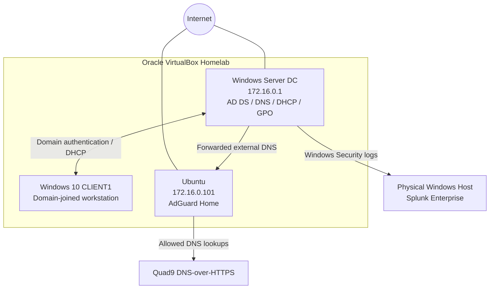

# Active Directory SOC Homelab

**Windows Server | Active Directory | Splunk Enterprise | Ubuntu | AdGuard Home**

## Project Overview

This project documents a virtualized Windows domain environment with centralized Windows Security monitoring and DNS filtering. The foundational Active Directory setup followed a tutorial by Josh Madakor; I expanded the environment with Splunk Enterprise and Ubuntu-based AdGuard Home to practice system administration, troubleshooting, and SOC investigation workflows.

This is an educational homelab, not a production deployment.

## Technologies Used

| Technology | Purpose |
|---|---|
| Oracle VirtualBox | Virtual machines and internal networking |
| Windows Server / Active Directory | Domain Controller, identity management, and authentication |
| DNS, DHCP, Group Policy | Name resolution, addressing, and centralized restrictions |
| Windows 10 CLIENT1 | Domain-joined workstation |
| Splunk Enterprise / Universal Forwarder | Centralized Windows Security log collection and analysis |
| Ubuntu / AdGuard Home | DNS filtering and query monitoring |
| Quad9 | DNS-over-HTTPS upstream resolver |

## Network Architecture



| Component | Configuration |
|---|---|
| AD domain | `mydomain.com` |
| Domain Controller | `172.16.0.1` |
| DHCP pool | `172.16.0.100–172.16.0.200` |
| AdGuard Home | `172.16.0.101` |
| Splunk Enterprise | Physical Windows host |

> **Configuration note:** The observed AdGuard address falls inside the DHCP pool. A DHCP exclusion/reservation or an address outside the pool, together with persistent IP configuration, is a future improvement.

## 1. Active Directory and Windows Server

Configured a Windows Server Domain Controller for `mydomain.com`, DNS and DHCP services, a domain-joined Windows 10 workstation, test accounts, Organizational Units, and Group Policy restrictions. The environment provided hands-on practice with domain authentication, identity administration, and virtual network troubleshooting.

**Evidence**


## 2. Splunk Enterprise — Security Monitoring

Installed Splunk Enterprise on the physical Windows host and configured Splunk Universal Forwarder on the Domain Controller. Verified that Windows Security logs were reaching Splunk and used SPL searches to investigate authentication activity.

**Verify log ingestion**

```spl
index=* sourcetype="WinEventLog:Security" host="DC"
| stats count by host
```

**Investigate failed logons (Event ID 4625)**

```spl
index=* sourcetype="WinEventLog:Security" host="DC" EventCode=4625
| table _time host EventCode Message
```

An observed Domain Controller event referenced the `a-wbryant` account and showed an incorrect-password failure (`0xC000006A`). Event ID `4776` was also observed. These logs demonstrate investigation capability, **not** a confirmed malicious attack or automated brute-force detection.

**Evidence**


## 3. Ubuntu and AdGuard Home — DNS Filtering

Installed AdGuard Home on an Ubuntu VM and configured the Domain Controller to forward external DNS queries to it. Enabled the AdGuard DNS filter and configured Quad9 DNS-over-HTTPS as the upstream resolver.

Verified query logging and tested filtering with:

```cmd
nslookup doubleclick.net. 172.16.0.101
```

AdGuard's Query Log showed A and AAAA queries for `doubleclick.net` **blocked** by the AdGuard DNS filter, with the Domain Controller (`172.16.0.1`) as the client.

**Evidence**


## Skills Demonstrated

- Windows Server, Active Directory, user accounts, and Organizational Units
- Group Policy, DNS, DHCP, and virtual networking
- Splunk Enterprise, Universal Forwarder, and SPL queries
- Windows Security event analysis and authentication troubleshooting
- Ubuntu Linux, DNS forwarding, and blocklist-based filtering
- Technical validation, troubleshooting, and documentation


## Conclusion

This homelab strengthened practical skills in Windows domain administration, security log investigation, Linux service configuration, and DNS filtering while providing a foundation for further IT and SOC projects.
